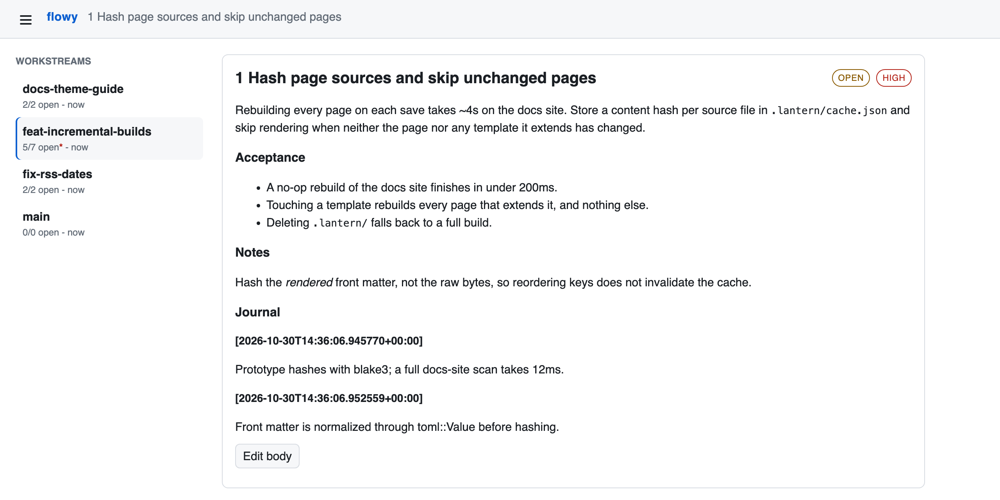

# flowy

`flowy` is a Rust CLI for managing bare git repos and per-branch worktrees with
markdown ticket files.

- [Example](#example)
- [On-disk layout](#on-disk-layout)
- [Installation](#installation)
- [Global options](#global-options)
- [Commands](#commands)
- [Claude Code skill](#claude-code-skill)

## Example

```console
$ flowy wt new -b feat/incremental-builds
Preparing worktree (new branch 'feat/incremental-builds')
HEAD is now at 6be9c45 Initial skeleton
Created worktree feat-incremental-builds
$ cd wt/feat-incremental-builds
$ flowy ticket add -p high "Hash page sources and skip unchanged pages"
Created 1
$ flowy ticket add "Show skipped/rebuilt counts in build output" \
    -d 'Print `built 3, skipped 241 in 180ms` so it is obvious the cache is working.'
Created 4

$ flowy wt ls
+-------------------------+---+-------------+-----------------+
| Branch                  |   | Last commit | Pending tickets |
+=============================================================+
| docs/theme-guide        |   | 2d          | 2/2             |
|-------------------------+---+-------------+-----------------|
| feat/incremental-builds | * | 1h          | 5/7             |
|-------------------------+---+-------------+-----------------|
| fix/rss-dates           |   | 5h          | 2/2             |
|-------------------------+---+-------------+-----------------|
| main                    |   | 3d          | 0/0             |
+-------------------------+---+-------------+-----------------+

$ flowy ticket ls

feat-incremental-builds
+---+------------------------------------------------+----------+---------+
| # | Title                                          | Priority | Status  |
+=========================================================================+
| 1 | Hash page sources and skip unchanged pages     | high     | pending |
|---+------------------------------------------------+----------+---------|
| 3 | Invalidate the cache when lantern.toml changes | medium   | pending |
|---+------------------------------------------------+----------+---------|
| 4 | Show skipped/rebuilt counts in build output    | medium   | pending |
|---+------------------------------------------------+----------+---------|
| 5 | Parallelize rendering with rayon               | low      | pending |
|---+------------------------------------------------+----------+---------|
| 6 | Watch mode: debounce rapid saves               | low      | pending |
+---+------------------------------------------------+----------+---------+

$ flowy ticket show 4
Show skipped/rebuilt counts in build output
priority: medium

Print `built 3, skipped 241 in 180ms` so it is obvious the cache is working.

$ flowy ticket done 4 --summary "Printed after every build, including watch mode."
done 4
$ flowy ticket journal 1 "Prototype hashes with blake3; a full scan takes 12ms."
Journal entry added to 1
```

## On-disk layout

```
project/
  .bare/                              # bare git repository
  .flowy/cache.json                   # per-worktree status cache
  .flowy/archive/<name>/              # archived workstreams, same shape
  wt/<safe-name>/                     # per-branch worktrees (/ replaced with -)
    .local/flowy/                     # workstream state, colocated with the code
      meta.toml                       # branch + worktree path
      status.md                       # append-only activity log
      planning.md                     # the current plan, if there is one
      next.md                         # rolling recommendation
      milestones/<n>-<slug>/          # a plan carried to its goal, frozen
      tickets/
        1.md                          # TOML frontmatter encodes status + priority
```

A workstream's notes live inside its worktree, so `cd`-ing into a worktree
gives you its tickets too. `wt archive` deletes the worktree, so archived notes
move to `.flowy/archive/`. You can delete `cache.json`, but keep the rest of
`.flowy/`.

Scaffolding adds `.local/` to `.bare/info/exclude` so the notes don't show up
as uncommitted changes. That file is local to your clone.

Ticket metadata lives in TOML frontmatter (`+++` delimiters) with `title`,
`status`, and `priority` fields. Status values: `"pending"`, `"complete"`,
`"wont-implement"`. Priority values: `"high"`, `"medium"`, `"low"`; a ticket with
no `priority` key ranks as medium, so the field can stay absent.
Ticket IDs are plain numbers (`1`, `2`, ...). Older zero-padded files like
`001.md` still work. Concurrent `ticket add` runs always get distinct numbers.

## Installation

### From a release

Each release on the [releases page](https://github.com/isabelgk/flowy/releases)
has a macOS binary for Apple Silicon (`aarch64-apple-darwin`) and Intel
(`x86_64-apple-darwin`):

```sh
VERSION=v0.5.0
TARGET=aarch64-apple-darwin   # or x86_64-apple-darwin
curl -fsSL "https://github.com/isabelgk/flowy/releases/download/$VERSION/flowy-$VERSION-$TARGET.tar.gz" | tar -xz
mv flowy ~/.local/bin/        # or anywhere on your PATH
```

The binaries are not signed. A copy downloaded through a browser is quarantined
by macOS; clear that with `xattr -d com.apple.quarantine flowy`.

### From source

With a Rust toolchain installed:

```sh
cargo install --git https://github.com/isabelgk/flowy
```

Or from a checkout, `just install` (`cargo install --path .`). The checkout's
`mise.toml` pins the Rust and `just` versions; `mise install` fetches both.

## Global options

| Flag | Description |
|------|-------------|
| `--repo-root <PATH>` | Path to repo root (default: auto-detect via `.bare` walk-up) |
| `--json` | Output as JSON |

## Commands

### `flowy init <name>`

Scaffold a new bare-repo project in the current directory.

### `flowy clone <url> [name]`

Clone a bare repo and scaffold the project structure.

### `flowy worktree` (alias: `wt`)

Manage bare git worktrees.

| Subcommand | Alias | Description |
|------------|-------|-------------|
| `new` | | Add a new worktree and its workstream directory |
| `ls` | | List worktrees with status, ticket counts, and branch age |
| `archive` | | Archive a workstream and remove its worktree |
| `unarchive` | | Restore an archived workstream |
| `rename` | `mv` | Rename a workstream: branch, worktree dir, and meta |

`new`, `unarchive`, and `flowy clone` initialize submodules in the worktree they
check out, recursively. Pass `--no-submodules` to skip this. If a submodule
fails to fetch, flowy prints a warning and still creates the worktree.

`rename <old-name> <new-branch>` renames the git branch, moves the worktree, and
updates `meta.toml`. It works on worktrees with submodules, which plain
`git worktree move` can't handle. Unarchive a workstream before renaming it.

### `flowy ticket`

Manage markdown tickets. Workstream defaults to the current git branch.

| Subcommand | Alias | Description |
|------------|-------|-------------|
| `list` | `ls` | List tickets |
| `show` | | Display a ticket |
| `add` | | Create a new ticket |
| `done` | | Mark a ticket as done |
| `priority` | | Set a ticket's priority |
| `journal` | | Append a journal entry to a ticket |
| `edit` | | Open a ticket in `$EDITOR` |
| `search` | | Search tickets with fuzzy matching |
| `status` | | Show workstream overview |

Use `-w / --workstream <NAME>` to target a workstream other than the current branch.

Tickets are sorted by priority, then by number. Set priority with
`add -p <high|medium|low>` or `priority <ID> <LEVEL>`, and filter with
`list -p <LEVEL>`.

```sh
flowy ticket add -p high "Crash on empty config"
flowy ticket priority 3 low
flowy ticket list -p high
```

`add`, `done`, and `journal` take text inline (`-d`, `--summary`, or the
journal argument). For longer markdown, use `--body-file <PATH>`, or
`--body-file -` to read stdin, and skip the shell quoting:

```sh
flowy ticket add "Parser rejects empty input" --body-file - <<'EOF'
## Scope
`parse_header` in src/parse.rs.

## Acceptance
Empty input returns Err rather than panicking.
EOF
```

You can't pass both `--body-file` and the inline form.

### `flowy notes`

Read and write a workstream's other files: `planning.md`, `next.md`,
`status.md`, `meta.toml`, and anything under `milestones/`. Workstream defaults
to the current git branch.

| Subcommand | Description |
|------------|-------------|
| `ls` | List the workstream's notes files, marking the absent ones |
| `path [NAME]` | Print the path to a note, or to the workstream directory |
| `show <NAME>` | Print a note |
| `write <NAME>` | Write a note, replacing it if it exists |
| `append <NAME>` | Append to a note, creating it if absent |
| `log <TEXT>` | Append a timestamped entry to `status.md` |
| `milestone <SLUG>` | Freeze `planning.md` and `next.md` under `milestones/<n>-<slug>/` |

`NAME` is either an alias (`planning`, `next`, `status`, `meta`) or a path
relative to the workstream directory (`milestones/1-parser/summary.md`).
Paths outside the workstream directory are rejected. `write` and `append`
read from stdin unless given `--body-file <PATH>`, create parent directories as
needed, and reject an empty body.

```sh
flowy notes write planning < plan.md
flowy notes append planning <<'EOF'
## Amendment
The `--fast` path turned out to be unnecessary.
EOF
flowy notes log "Planning complete. 4 tickets created."
```

`milestone` creates the next numbered milestone directory, moves `planning.md`
and `next.md` into it, and logs the boundary in `status.md`. Tickets aren't
moved and keep one numbering sequence for the whole workstream. It lists any
pending tickets but doesn't fail on them. Write `summary.md` yourself.

### `flowy migrate`

Move a repo created by an older flowy onto the current layout:

- `worktrees/` moves to `wt/`, fixing up git's worktree and submodule pointers.
- `<worktree>/.local/workstream/` and `notes/workstreams/<name>/` move to
  `<worktree>/.local/flowy/`.

The archive isn't touched. Anything that would overwrite an existing path, or
notes with no matching worktree, are skipped and reported. Run it from outside
`worktrees/`. It's safe to re-run after a failure. `--dry-run` shows what would
move.

### `flowy web`

Serve a browser UI for the repo's workstreams over HTTP.

<picture>
  <source media="(prefers-color-scheme: dark)" srcset="docs/web-dark.png">
  
</picture>

```sh
flowy web                      # binds a free port and prints the URL
flowy web --port 9000 --open   # pin the port and open a browser
```

Without `--port`, the OS picks a free port, so you can serve several repos at
once.

The sidebar lists live worktrees. Each has a filterable ticket list, a page per
ticket, and forms for the CLI's ticket actions: add, done, won't-implement,
reopen, priority, and journal. `Edit body` edits the markdown below the
frontmatter; title, status, and priority have their own forms. If the ticket
changed on disk since you opened the editor, the save is rejected instead of
overwriting it.

Changes are logged to `status.md` like the CLI's. Body edits also log
`edited <id>`.

Archived workstreams aren't shown; unarchive one to see it.

The server listens on `127.0.0.1`, serves one repo, and handles one request at
a time. It rejects POSTs from other origins, so other sites can't modify your
tickets.

### `flowy completions <shell>`

Generate shell completions. Supported shells: `bash`, `zsh`, `fish`,
`powershell`, `elvish`.

```sh
flowy completions zsh > "${fpath[1]}/_flowy"
flowy completions bash > /etc/bash_completion.d/flowy
flowy completions fish > ~/.config/fish/completions/flowy.fish
```

## Claude Code skill

`skills/flowy/` is a Claude Code skill for using flowy: writing a plan,
breaking it into tickets, journaling as you go, and archiving when done.
Install it with:

```sh
just skill-link      # symlink into ~/.claude/skills; edits here take effect at once
just skill-install   # copy into ~/.claude/skills, pinned against further edits
```

Both replace anything already at `~/.claude/skills/flowy`. For a single
project, copy it into that project's `.claude/skills/` instead.

It has seven commands, and also responds to the same requests in plain
language:

```
/flowy new igk/my-feature                      # branch + worktree + notes
/flowy plan igk-my-feature                     # planning.md + tickets
/flowy ticket igk-my-feature "crash on EOF"    # one ad-hoc ticket
/flowy next igk-my-feature                     # what to pick up, into next.md
/flowy implement igk-my-feature 3              # build, journal, mark done
/flowy milestone igk-my-feature no-lua         # freeze a reached plan, keep going
/flowy close igk-my-feature                    # audit + archive
```

`plan` overwrites `planning.md`, so when a plan is finished but the branch
isn't, run `milestone` first. It calls `flowy notes milestone` and writes the
summary.
